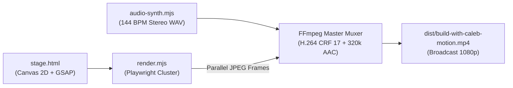

# ⚡️ Hyper-Motion Engine

> **Deterministic 60 FPS Motion Graphics & Launch Video Engine in Pure Code**  
> *Zero After Effects. Zero Premiere. Zero UI app dependencies. 100% Code-Driven, Git-Versioned, Headless Cinema.*

Built for **[Build with Caleb](https://build-with-caleb.vercel.app)** by Caleb Blickteig ([@clickteig11-byte](https://github.com/clickteig11-byte)).

---

## 🎯 Overview

**Hyper-Motion Engine** is an open-source, code-first video production pipeline designed for engineers and AI agents. It renders broadcast-grade 1080p60 launch reels, kinetic typography teasers, and software release trailers directly from HTML5 Canvas, GSAP, and Web Audio synthesis using parallelized Playwright Chromium instances and FFmpeg.

### ⚡️ Why Code-First Motion?

| Traditional After Effects / Premiere | Hyper-Motion Engine |
| :--- | :--- |
| ❌ Heavy GUI application install required | ✅ Runs headlessly on any Mac/Linux/Cloud runner |
| ❌ Binary `.aep` / `.prproj` files can't be diffed | ✅ 100% plain text JavaScript/HTML, diffable via Git |
| ❌ Manual timeline adjustments per resolution | ✅ Procedural time step: render any FPS (30/60/120) deterministically |
| ❌ Royalty / license issues with stock music | ✅ Built-in procedural 144 BPM stereo audio synthesizer |
| ❌ Slow human iteration loops | ✅ **52x faster iteration** from prompt to finished MP4 |

---

## 🏗 System Architecture

The engine functions as a 4-tier synchronized pipeline:



1. **Procedural Audio Engine (`audio-synth.mjs`)**:
   - Generates an uncompressed 48 kHz 16-bit stereo PCM WAV file.
   - Algorithmic synthesis for analog pitch-drop kicks, crisp wooden rimshots, tactile mechanical word pops, stereo whip-whooshes, and warm Rhodes electric piano chords.
   - Beat-locked to 144 BPM with exact millisecond precision.

2. **Kinetic Typography Stage (`stage.html`)**:
   - High-contrast Swiss/Editorial layout (1920×1080) powered by HTML5 2D Canvas.
   - Custom loaded **Anton** ultra-condensed headline type and **Inter Variable** body text.
   - Deterministic `window.__renderFrameAt(t)` hook evaluating exact coordinates, alphas, scales, and rotation at any timestamp `t`.

3. **Chromium Raster Cluster (`render.mjs`)**:
   - Launches a headless Playwright Chromium cluster (default 4 parallel workers).
   - Rasterizes the timeline into numbered high-quality JPEGs in parallel.
   - Extracts Frame 0 automatically as a clean launch poster (`dist/poster.jpg`).

4. **FFmpeg Hardware-Accelerated Muxer**:
   - Encodes frames via `libx264` with `-preset fast -crf 17` and `-pix_fmt yuv420p`.
   - Tags BT.709 broadcast color space and color primaries.
   - Muxes audio with 320 kbps stereo AAC and injects `+faststart` for instant web streaming.

---

## 🚀 Quickstart

### Prerequisites
- **Node.js**: v18+ or v20+
- **FFmpeg**: Installed and available on system `$PATH` (`brew install ffmpeg` or `apt-get install ffmpeg`)
- **Chromium / Google Chrome**

### Installation
```bash
# Clone the repository
git clone https://github.com/clickteig11-byte/hyper-motion-engine.git
cd hyper-motion-engine

# Install Playwright dependencies
npm install
npx playwright install chromium
```

### Running Renders
```bash
# 1. Render standard 30 FPS Master Video (30.0s @ 1080p)
npm run render

# 2. Render butter-smooth 60 FPS Master Video (1800 frames)
npm run render:60fps

# 3. Generate or test procedural soundtrack standalone
npm run synth:audio

# 4. Preview interactive stage live in browser
npm run preview
# Open http://localhost:3000/stage.html in your browser
```

Outputs are saved in the `./dist/` directory:
- `dist/build-with-caleb-motion.mp4` (~6.9 MB)
- `dist/poster.jpg` (Thumbnail snapshot)
- `dist/soundtrack.wav` (48 kHz Stereo Master)

---

## 🎨 Creative Direction & Style Tokens

Hyper-Motion Engine features a warm, tactile editorial palette inspired by premium Swiss design journals and modern developer tools:

```javascript
export const StyleTokens = {
  colors: {
    bgPaper: '#F6F5F1',        // Warm museum paper
    textInk: '#111111',        // Sovereign dark carbon
    textSecondary: '#666660',  // Muted editorial secondary
    accentTerracotta: '#C94A29', // Build-with-Caleb signature vermilion
    borderHairline: '#D6D3CB', // Subtle tactile borders
    darkOverlay: '#141416'     // Cinema dark contrast
  },
  typography: {
    headline: 'Anton, "AntonLocal", -apple-system, sans-serif',
    body: 'Inter, "InterLocal", sans-serif',
    mono: '"JetBrains Mono", monospace'
  },
  rhythm: {
    bpm: 144,
    quarterNoteMs: 416.67,
    sixteenthNoteMs: 104.17
  }
};
```

---

## 🎬 30-Second Storyboard Structure

The included launch reel executes a 6-act narrative arc:

| Act | Timestamp | Title | Visual & Motion Mechanics | Sound Design |
| :---: | :---: | :---: | :--- | :--- |
| **1** | `0.0s – 3.2s` | **THE SPARK** | Minimalist aperture card opens. Soft grain, clean micro-badge, and subtle ambient drift. | Warm Rhodes chime + sub-bass pulse |
| **2** | `3.2s – 9.0s` | **THE SHIFT** | Typography expands dramatically. Anton lettering snaps into place on sixteenth notes. | 144 BPM analog kicks + wooden rimshots |
| **3** | `9.0s – 14.5s` | **HUMAN ENERGY** | Full-bleed hero portrait of Caleb with precision hairline frame and kinetic taglines. | Stereo whip-whoosh + mechanical word pops |
| **4** | `14.5s – 19.5s` | **THE METHOD** | 3-step sovereign pipeline: `01 / IDEA`, `02 / CODE`, `03 / FILM`. | Triple punch kicks + stereo rimshots |
| **5** | `19.5s – 24.5s` | **VELOCITY** | Huge `52X` benchmark typography lockup with glowing counter lines. | Low-pass filter sweep + rocket riser |
| **6** | `24.5s – 30.0s` | **CLIMAX & CTA** | Triad cadence: `CODE. BUILD. REPEAT.` resolving to Sovereign Logo Lockup & URL. | Final master hit + resonant warm reverb |

---

## 🤖 AI Agent Integration Guide

Hyper-Motion Engine is designed from the ground up for autonomous agent execution.

### 1. Google Antigravity (AGY)
To have Antigravity generate a custom video for any repository:
```markdown
Read stage.html and audio-synth.mjs. Update the copy tokens, product screenshots,
and tempo to match our project, then execute `npm run render` and verify the MP4 in dist/.
```

### 2. Claude Code & Cursor
When pairing with Claude Code or Cursor, prompt the agent:
```markdown
Modify `hyper-motion-engine/stage.html` to create a 15-second teaser for [Your App].
Ensure `window.__renderFrameAt(t)` remains strictly deterministic without `requestAnimationFrame`.
Run `npm run render` and inspect the generated poster and video.
```

### 3. OpenAI Codex / GitHub Copilot
Pass `stage.html` and `audio-synth.mjs` as context files when generating new motion sequences or algorithmic audio effects.

---

## 📂 Repository Contents

```
hyper-motion-engine/
├── package.json              # Scripts & Playwright dependencies
├── stage.html                # 1080p deterministic canvas motion stage
├── render.mjs                # Playwright Chromium cluster rasterizer & FFmpeg muxer
├── audio-synth.mjs           # 144 BPM procedural stereo audio synthesizer
├── caleb-actual-photo-data.js # Base64 photo asset for offline self-contained rendering
├── fonts/
│   ├── Anton-Regular.ttf     # Offline headline font
│   └── InterVariable.woff2   # Offline body typography
├── dist/
│   ├── build-with-caleb-motion.mp4 # Pre-rendered 30s master release video
│   ├── poster.jpg            # Frame 0 thumbnail
│   └── soundtrack.wav        # Procedural WAV soundtrack
└── README.md                 # Complete documentation & agent guide
```

---

## 📄 License

MIT License © 2026 Caleb Blickteig ([@clickteig11-byte](https://github.com/clickteig11-byte)).  
Free for personal and commercial video generation.
